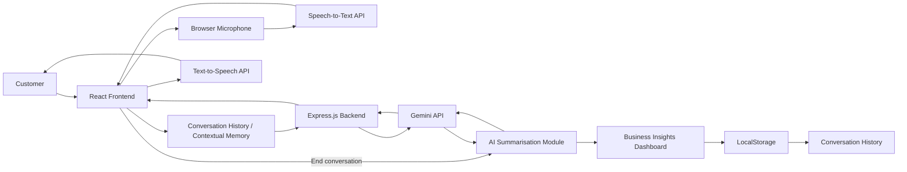
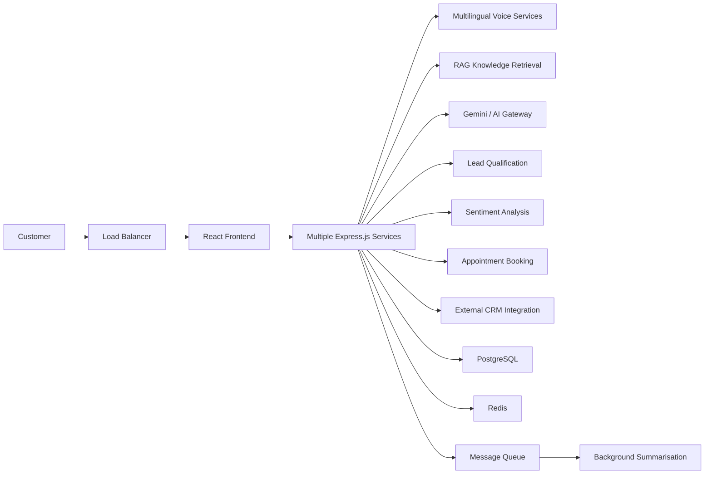

# System Architecture

## Implemented MVP architecture

## Implemented data flow
The customer speaks or types. Browser speech recognition converts voice to text. React keeps the current transcript and sends the latest message plus relevant history to Express. Express applies the TechNova sales prompt and calls Gemini. Gemini returns a short response, React displays it, and the browser Text-to-Speech API speaks it.

When the user ends the conversation, React sends the transcript to Express. The summarisation module asks Gemini to return JSON fields, validates missing values and interest level, then displays the result in Business Insights. Completed summaries are saved in browser LocalStorage and can be viewed or deleted.

## Proposed future production architecture

The production diagram is a proposed architecture, not implemented in the MVP.
